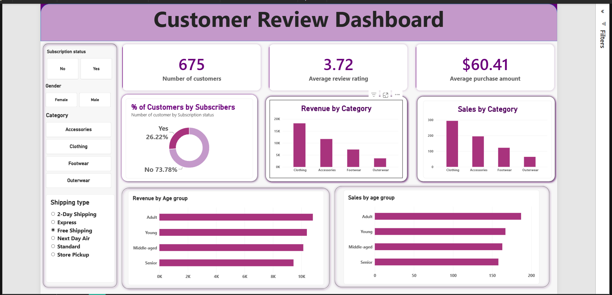

# Customer Shopping Behavior Analysis

An end-to-end data analytics portfolio project exploring customer purchase patterns, product ratings, discount usage, shipping preferences, customer segments, and subscription behavior using **Python, MySQL, and Power BI**.

> **Project provenance:** This project was developed by following and adapting a tutorial by [Amlan Mohanty](https://www.youtube.com/@amlanmohanty1). The notebook, SQL queries, report, and dashboard should be reviewed and personalized with your own analysis before presenting this as portfolio work. Tutorial inspiration and source: [YouTube walkthrough](https://www.youtube.com/watch?v=5PrZvPeUw60). Do not imply the original tutorial or dataset is your original creation.

## Project objective

Use customer shopping data to answer practical business questions and present findings in an interactive dashboard. The accompanying report describes a dataset of **3,900 purchase records and 18 columns**, including 37 missing values in the review-rating field.

## Tools and skills

- **Python:** pandas, exploratory data analysis, missing-value treatment, column standardization, feature engineering
- **MySQL 8.0+:** aggregations, subqueries, conditional logic, CTEs, window functions
- **Power BI:** interactive dashboard, KPI cards, category comparisons, age-group analysis, slicers
- **Reporting:** business questions, insight communication, recommendations

## Workflow

1. **Explore and clean the data in Python**
   - Inspect structure and summary statistics.
   - Impute missing review ratings using the median rating within each product category.
   - Standardize column names.
   - Create age groups and a purchase-frequency-in-days feature.
   - Check whether `discount_applied` and `promo_code_used` contain redundant information before dropping a field.
2. **Load the prepared dataset into MySQL**
   - Load the cleaned DataFrame to a table named `customer`.
3. **Answer business questions with SQL**
   - Revenue by gender
   - Above-average spend among discount users
   - Highest-rated products
   - Standard versus Express shipping spend
   - Subscriber versus non-subscriber spend and revenue
   - Products with the highest discount-use rates
   - Rule-based customer segments
   - Top products within each category
   - Subscription status among repeat buyers
   - Revenue by age group
4. **Visualize results in Power BI**
   - Use the included `.pbix` file to explore the dashboard and its filters.
5. **Document findings**
   - Use the report and dashboard to explain what the results mean for business decisions.

## Repository structure

```text
.
├── customer_shopping_behavior_analysis.ipynb
├── customer_behavior_sql_queries.sql
├── endtoendpbi.pbix
├── Customer Shopping Behavior Analysis.pdf
├── README.md
└── screenshots/
    ├── powerbi_dashboard.png
    ├── python_data_cleaning.png
    ├── sql_revenue_by_gender.png
    └── ...
```

The CSV dataset is not included in this starter package. Add it only if you have the right to redistribute it, and document its source. If you do not include it, tell readers how to obtain it from the original source rather than implying it is bundled here.

## How to run the project

### 1. Prepare the dataset

Place the dataset file in the project folder and name it `customer_shopping_behavior.csv`, or update the path in the notebook to match your local filename.

### 2. Install Python dependencies

In a notebook cell, run:

```python
%pip install pandas sqlalchemy pymysql
```

### 3. Configure MySQL

Create the database and set the credentials in your local environment. **Do not put passwords in the notebook or commit them to GitHub.**

Example environment variables:

- `MYSQL_USER` — your MySQL username
- `MYSQL_PASSWORD` — your MySQL password
- `MYSQL_HOST` — usually `localhost`
- `MYSQL_PORT` — usually `3306`
- `MYSQL_DATABASE` — `customer_behavior`

The notebook reads these variables when creating the SQLAlchemy connection. Set them in your operating system or IDE before running the connection cell.

### 4. Run the notebook

Run `customer_shopping_behavior_analysis.ipynb` from top to bottom. Confirm the data file loads, inspect the cleaning steps, and load the prepared data into the MySQL `customer` table.

### 5. Run the SQL queries

Open `customer_behavior_sql_queries.sql` in MySQL Workbench or another MySQL client after the `customer` table has been created. Run the queries and validate the results against your own dataset.

### 6. Open the Power BI report

Open `endtoendpbi.pbix` in Power BI Desktop. If the report asks for credentials or cannot refresh, update its data-source settings to point to your local MySQL database. Verify that visuals refresh before taking final screenshots.

## Findings documented in the accompanying report

The supplied report records the following example results. Re-run the analysis and confirm these figures against your final notebook and dashboard before relying on them:

- The dataset contains 3,900 records, 18 columns, and 37 missing review-rating values.
- Average purchase amount is reported as approximately **$59.76** and average review rating as **3.75**.
- Express shipping has a higher average purchase amount than Standard shipping in the report's SQL results.
- The report recommends reviewing subscription benefits, customer loyalty initiatives, discount policy, product positioning, and targeted marketing.

These are descriptive results from the provided project materials, not evidence of causation. The dataset's purchase amount is in USD according to the report's field naming.


```markdown
## Dashboard preview


```

Only include screenshots that you have captured from your own working files. Ensure the visuals and query outputs are legible at normal GitHub viewing size.

## Business recommendations to validate

- **Subscription strategy:** Investigate whether subscriber benefits could improve sign-ups and retention.
- **Customer loyalty:** Test suitable rewards for repeat buyers.
- **Discount policy:** Compare discount-driven sales with profitability or margin data before changing promotions.
- **Product positioning:** Feature products with strong ratings and sales, while checking sample sizes.
- **Targeted marketing:** Use age-group and shipping patterns as hypotheses to test, not as proof of customer preference.

## Limitations

- This analysis is based on observational transaction data; it does not establish causality.
- The simple customer segments are rule-based and depend on the chosen purchase-count thresholds.
- The project does not include profit or margin data, so revenue should not be interpreted as profit.
- Dashboard refresh and database connection settings may need to be configured on another computer.

## Acknowledgment

Thanks to **Amlan Mohanty** for the tutorial that inspired this project. This repository should retain attribution to the tutorial and to the dataset's original source. Add any dataset license or redistribution terms here after verifying them.

---

**Author:** Nethravathi H. S.  
**Portfolio purpose:** Demonstrating an end-to-end analytics workflow using Python, SQL, and Power BI.
